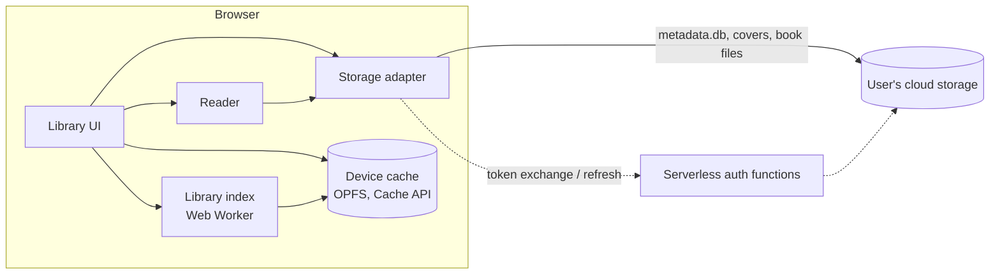

# calibre-cloud: High-Level Design

Status: the first slice is built: browse, search, book detail, and download from a MEGA shared folder. The reader is built for EPUB, KEPUB, PDF, MOBI, PRC, AZW, AZW3, KF8, FB2, FBZ, and CBZ. Google Drive and Dropbox are not built yet.

## Goal

Let users browse and read their Calibre library in a browser, with nothing to install, straight from the cloud storage it already lives in.

### Non-goals

- Editing the library. Calibre on the desktop stays the source of truth.
- Hosting or syncing anyone's books.
- Replacing the Calibre content server for users who already run one.

## Principles

| Principle | What it means for the design |
|---|---|
| Zero install | The whole user experience is a web app. No desktop agent, browser extension, or Calibre install. |
| Client-first | Storage access, library queries, and book rendering run in the browser. |
| Small serverless backend allowed | Functions handle only what a browser can't, such as OAuth steps that need a client secret. They store nothing. |
| Costs scale to zero | Nothing costs money while idle. File bytes never go through our backend, so cost doesn't grow with users or library size. |
| Read-only | The app never writes to the user's library. |

## Architecture

### Components

- **Storage adapter:** one per provider, all behind a single interface of two operations, each taking a path relative to the library root:
  - `stat`: the file's size and a version that changes when the file does.
  - `read`: the whole file as a Blob, with progress and cancellation.

  Every failure is one of five provider-neutral errors: `NotFound`, `ReconnectRequired`, `QuotaExceeded`, `Network`, `Aborted`. The UI explains errors in these terms only.
- **Storage provider:** each provider also owns its connect input (for MEGA, a folder link and its validation) and the shape of its saved connection. Only the storage layer knows the providers; everything above it sees a connection and an adapter. ESLint enforces this boundary and keeps each provider's SDK inside its adapter.
- **Library index:** the official SQLite WASM build in a Web Worker opens `metadata.db` (the SQLite file Calibre keeps at the library root) read-only and answers browse and search queries over a small typed message API. Queries use Calibre's base tables, not its views or SQL functions.
- **Library UI:** browse and search by author, series, tag, and other metadata, showing covers.
- **Reader:** renders a book file in the browser, with one renderer per supported format: foliate-js for EPUB, KEPUB, MOBI, PRC, AZW, AZW3, KF8, FB2, FBZ, and CBZ, and pdf.js for PDF. foliate-js picks CBZ, FB2, and FBZ by file name, so the renderer names the file with the format's extension. Every other format is download-only. A link out of a book never opens by itself: the reader shows its URL and asks first, and opens only `http:`, `https:`, and `mailto:` links, in a new tab with no opener or referrer.
- **Serverless auth functions (optional):** OAuth code exchange and token refresh for providers that need a client secret. Each call is stateless and small.

### Main flow

1. The user connects a provider and picks their library folder. The connection is saved in localStorage.
2. The storage adapter downloads `metadata.db`, and the library index opens it and keeps it on the device.
3. The UI queries the index and fetches covers as they scroll into view.
4. Opening a book fetches only that book's file, and the reader renders it.

A Calibre library can be many GB, but only `metadata.db` is needed to list the whole library. Everything else is fetched when it's needed.

### Caching on the device

- `metadata.db` lives in OPFS through SQLite's `opfs-sahpool` VFS. The version `stat` reported for it is kept in localStorage.
- A returning visit opens the cached copy at once. The app calls `stat('metadata.db')` once per page load and on "Refresh library", with no polling. A new version downloads to a separate file and replaces the old one only when complete.
- If the check fails, the cached library stays browsable with a banner saying why.
- Only one tab can hold the OPFS pool, so a second tab asks the user to close the first.
- Where OPFS is unavailable, the library is held in memory and downloaded on every visit.
- Covers are cached in the Cache API, keyed by book and its `last_modified`. The grid and the detail page share this one cache, since Calibre stores a single `cover.jpg` per book. Whenever a downloaded `metadata.db` is opened, cached covers it no longer refers to are deleted.
- The reader keeps the last 3 opened book files in the Cache API, keyed by book, format, and the version `stat` reports. Opening a book calls `stat` first and skips the download when the version matches; if `stat` fails with `Network` and a cached copy exists, that copy opens. Opening a 4th book evicts the least recently opened. A failed cache write is ignored and the book opens from the downloaded Blob. Entries for books no longer in the library are deleted on a library refresh.
- The Download button never reads or writes that cache.
- The reader saves a reading position per book and format in localStorage (foliate-js formats: the CFI at the start of the visible range; PDF: the page number, each with a progress fraction and timestamp), on every relocation and when the reader closes. A changed book file keeps its position. Reader settings (font size, theme) are device-wide and apply to reflowable books only; CBZ and fixed-layout EPUB pages are shown untinted at fit-page with no zoom. PDF zoom is not saved and every open starts at fit-width.
- The home view's Continue reading row lists the 6 most recently opened formats from those positions and opens the reader at the saved position. A library refresh deletes positions whose book or format is gone.
- After connecting, the app asks for persistent storage. Disconnect deletes the saved connection, the cached library, the covers, the reader's book files, and reading positions. Reader settings stay.

## Stack and hosting

- **Frontend:** React, Vite, TypeScript, TanStack Router and TanStack Query, Tailwind.
- **SQLite:** the official `@sqlite.org/sqlite-wasm` build, run in a Web Worker.
- **Hosting:** a Cloudflare Worker serving static assets, with SPA fallback and a strict CSP set in platform config, not code. The reader renders each foliate-js section or comic page in a same-origin `blob:` frame, which needs `style-src 'self' 'unsafe-inline' blob:`, `frame-src blob:`, and `frame-ancestors 'self'`; `script-src` stays `'self' 'wasm-unsafe-eval'`, so scripts inside a book never run. No serverless functions yet; MEGA needs none.
- **Tests:** Vitest in browser mode (Chromium), driving the whole app against an in-memory fake storage adapter.

## Storage providers

| Provider | Auth | Addressing | Notes |
|---|---|---|---|
| Dropbox | OAuth with PKCE, works from the browser alone | Path-based | Simplest fit. |
| Google Drive | OAuth. Long sessions need a serverless refresh function | ID-based, so paths are resolved folder by folder | Scope choice is the main risk (below). |
| MEGA | No OAuth | Encrypted nodes, decrypted in the browser | Use a shared folder link instead of the user's password. |

## Cost model

- **Static hosting:** free tier or close to it.
- **Serverless functions:** pay per request, called only during sign-in and token refresh.
- **Bandwidth for books and `metadata.db`:** carried by the user's storage provider, never by us.

## Risks and open questions

1. **Google Drive scope:** `drive.readonly` is a restricted scope. Unverified apps are capped at 100 users, and verification can require a paid annual security assessment, which would break "costs scale to zero". `drive.file` with the Google Picker avoids this, but it's unconfirmed whether picking a folder grants access to the files inside it. Prototype this before building the Drive adapter.
2. **MEGA transfer quota:** free accounts have a bandwidth limit, so large books may fail to download. A download that hits the quota fails at once with `QuotaExceeded` rather than retrying.
3. **Formats:** settled. Every format foliate-js or pdf.js reads is read in the browser; every other format is download-only.
