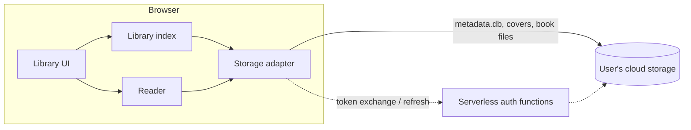

# calibre-cloud: High-Level Design

Status: draft. Nothing is implemented yet.

## Goal

Let users browse and read their Calibre library in a browser, with nothing to install, straight from the cloud storage it already lives in.

### Non-goals

- Editing the library. Calibre on the desktop stays the source of truth.
- Hosting or syncing anyone's books.
- Replacing the Calibre content server for users who already run one.

## Principles

| Principle | What it means for the design |
|---|---|
| Zero install | The whole user experience is a web app. No desktop agent, browser extension, or Calibre install. |
| Client-first | Storage access, library queries, and book rendering run in the browser. |
| Small serverless backend allowed | Functions handle only what a browser can't, such as OAuth steps that need a client secret. They store nothing. |
| Costs scale to zero | Nothing costs money while idle. File bytes never go through our backend, so cost doesn't grow with users or library size. |
| Read-only | The app never writes to the user's library. |

## Architecture

### Components

- **Storage adapter:** one per provider, all behind a single interface: list a folder, and read a file by its path relative to the library root. Nothing above this layer knows which provider is in use.
- **Library index:** loads `metadata.db` (the SQLite file Calibre keeps at the library root) into an in-browser SQLite engine and answers browse and search queries.
- **Library UI:** browse and search by author, series, tag, and other metadata, showing covers.
- **Reader:** renders a book file in the browser, with one renderer per supported format.
- **Serverless auth functions (optional):** OAuth code exchange and token refresh for providers that need a client secret. Each call is stateless and small.

### Main flow

1. The user connects a provider and picks their library folder.
2. The storage adapter downloads `metadata.db` once, and the library index opens it.
3. The UI queries the index and fetches covers as they scroll into view.
4. Opening a book fetches only that book's file, and the reader renders it.

A Calibre library can be many GB, but only `metadata.db` is needed to list the whole library. Everything else is fetched when it's needed.

## Storage providers

| Provider | Auth | Addressing | Notes |
|---|---|---|---|
| Dropbox | OAuth with PKCE, works from the browser alone | Path-based | Simplest fit. |
| Google Drive | OAuth. Long sessions need a serverless refresh function | ID-based, so paths are resolved folder by folder | Scope choice is the main risk (below). |
| MEGA | No OAuth | Encrypted nodes, decrypted in the browser | Use a shared folder link instead of the user's password. |

## Cost model

- **Static hosting:** free tier or close to it.
- **Serverless functions:** pay per request, called only during sign-in and token refresh.
- **Bandwidth for books and `metadata.db`:** carried by the user's storage provider, never by us.

## Risks and open questions

1. **Google Drive scope:** `drive.readonly` is a restricted scope. Unverified apps are capped at 100 users, and verification can require a paid annual security assessment, which would break "costs scale to zero". `drive.file` with the Google Picker avoids this, but it's unconfirmed whether picking a folder grants access to the files inside it. Prototype this before building the Drive adapter.
2. **MEGA transfer quota:** free accounts have a bandwidth limit, so large books may fail to download.
3. **Large `metadata.db`:** big libraries mean a slow first load. Caching it in the browser between visits is undecided.
4. **Formats:** which formats the reader supports, beyond the obvious EPUB and PDF.
5. **Stack:** frontend framework, SQLite engine, and serverless platform are not chosen yet.
